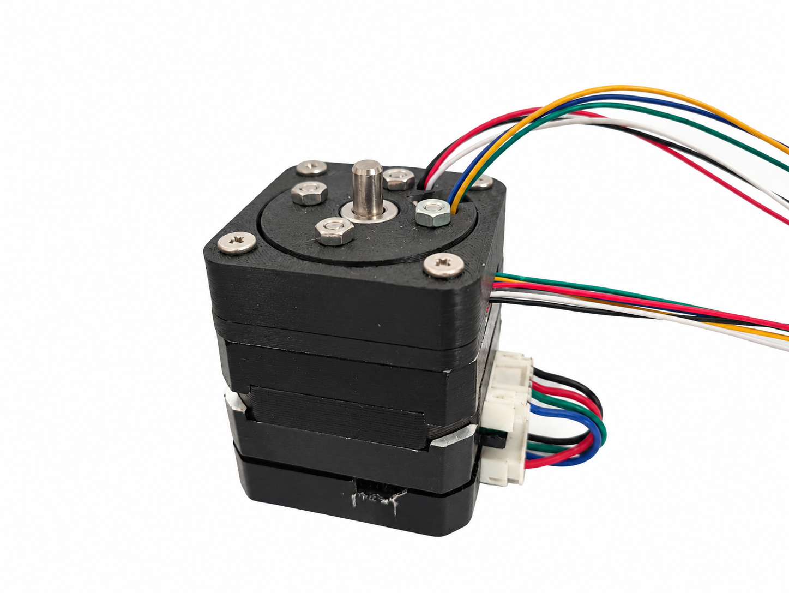
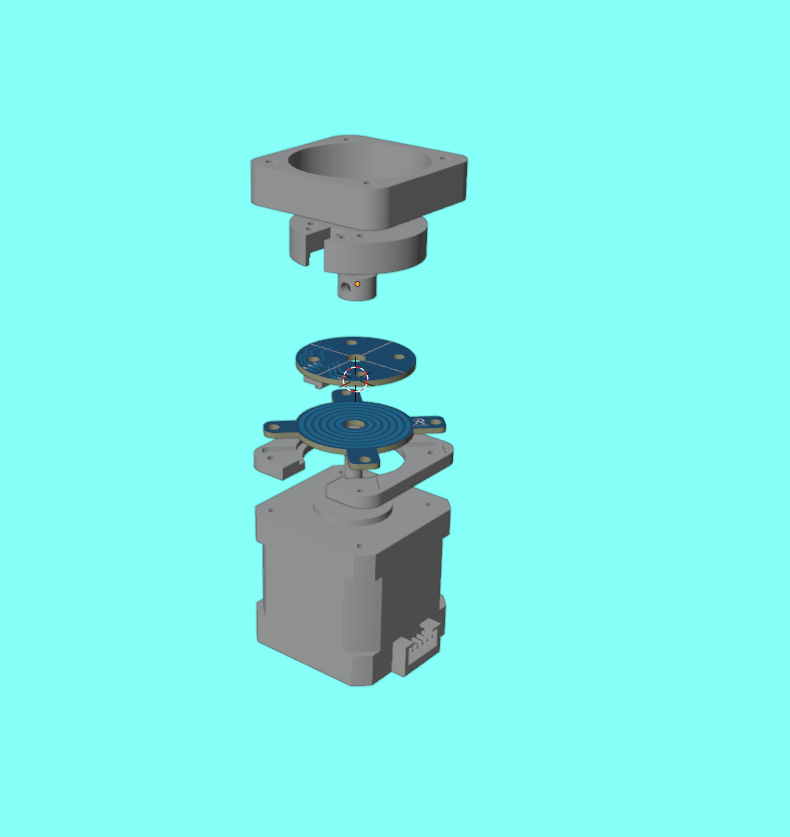
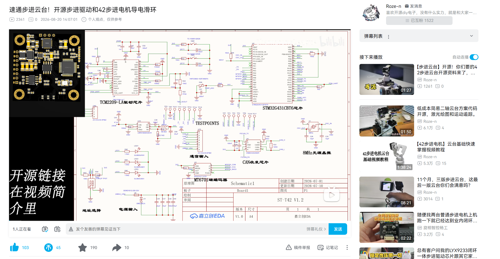

# 42步进电机导电滑环

**6-Channel Slip Ring for 42 Stepper Motor Projects**

一款用于42步进电机旋转机构的6路导电滑环，通过PCB导电环与充电弹片接触，实现旋转部件之间的电气连接，减少线束缠绕，适用于双轴云台、机器人及DIY项目。

本项目提供PCB工程、3D打印模型和材料清单，采用 [CERN-OHL-S-2.0](./LICENSE) 开源协议。

## 实物展示

## 视频演示

[B站主页](https://space.bilibili.com/411238848)

## 目录说明

| 目录 | 内容 |
| --- | --- |
| [3d_model模型](./3d_model模型/) | 导电滑环顶板外壳、底板外壳及整外壳的STL打印模型 |
| [PCB文件](./PCB文件/) | 上下两块PCB的嘉立创EDA专业版工程及导入说明 |
| [BOM清单](./BOM清单/) | 制作导电滑环所需的材料清单 |
| [assets](./assets/) | README使用的实物图片、装配图及视频封面 |

## 材料清单

以下为制作一个导电滑环所需的材料：

| 材料 | 规格 | 数量 |
| --- | --- | --- |
| 3D打印件 | 见3d_model模型目录 | 1套 |
| 顶死 | 内径5mm、外径10mm、高度6mm | 1个 |
| 螺丝 | M3×10mm | 4颗 |
| 螺母 | M3 | 4颗 |
| 螺丝 | M3×17mm | 4颗 |
| 充电弹片 | 2.0mm间距、6P | 2个 |
| 顶板PCB | 沉金 | 1块 |
| 底板PCB | 沉金 | 1块 |

## 配套项目

- [42步进电机双轴云台](https://github.com/1925loyve/42-stepper-pan-tilt)：配套双轴云台结构及3D打印模型。
- [ST42步进驱动板](https://github.com/1925loyve/Step42-ClosedLoop-Stepper-Drive)：配套步进驱动板的硬件及固件资料。

## 淘宝购买

如果你不方便自行PCB打样、3D打印、采购零件和装配，也可以通过下方淘宝链接购买制作好的导电滑环，省去自行制作的步骤，方便快速搭建自己的项目。

[淘宝购买导电滑环](https://item.taobao.com/item.htm?id=1084549484175)
